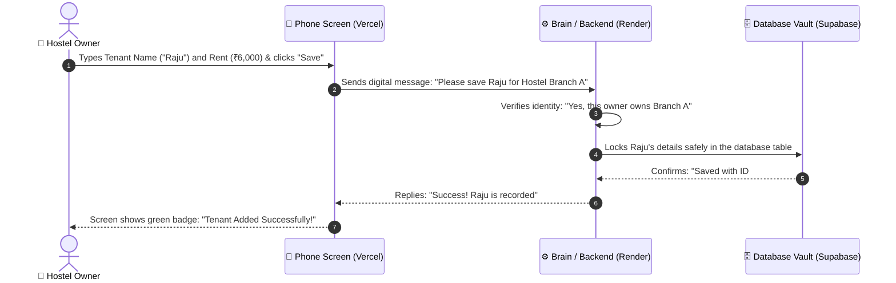

# HostelDesk — System Design Explained in Plain & Simple Words

> **Who is this guide for?**  
> Anyone! You do not need to be a software engineer or computer expert to understand this. It uses simple everyday examples (like a bank, a hotel, and a restaurant) so anyone can easily understand how HostelDesk works.

---

## 1. What is HostelDesk? (The Big Picture)

Imagine you own one or more **Hostels / Paying Guest (PG) buildings**. Every month, you have to:
* Remember who has paid rent and who owes you money.
* Keep track of empty beds and full rooms.
* Pay electricity, water, and maintenance bills.
* Send rent reminders to boys or girls staying in your rooms.

Doing this in a paper notebook is messy, mistakes happen, and pages get lost. **HostelDesk** is a smart digital notebook that runs on your phone and laptop, doing all the hard math and tracking automatically.

---

## 2. The 3 Core Parts: The Restaurant Analogy

Think of HostelDesk like a **famous restaurant**:

```
+-------------------------------------------------------------+
| 1. FRONTEND (The Waiter & The Menu)                        |
| Hosted on: Vercel (https://hosteldesk-ten.vercel.app)       |
| • What the customer sees, clicks, and types on.             |
+-------------------------------------------------------------+
                              ↓ (Sends your request)
+-------------------------------------------------------------+
| 2. BACKEND (The Kitchen & The Head Chef)                   |
| Hosted on: Render (https://hosteldesk-x1f4.onrender.com)    |
| • Does the thinking, checks your password, does the math.   |
+-------------------------------------------------------------+
                              ↓ (Stores & fetches goods)
+-------------------------------------------------------------+
| 3. DATABASE (The Locked Storeroom / Bank Vault)             |
| Hosted on: Supabase (PostgreSQL Database)                   |
| • Safe storage for rooms, tenants, payments, and passwords. |
+-------------------------------------------------------------+
```

### Part 1: The Frontend (The Counter & The Menu)
* **What is it?** The colorful screen you see on your phone or laptop. It has buttons like **"Add Room"**, **"Add Tenant"**, and **"Log Out"**.
* **Where does it live?** On **Vercel** (`https://hosteldesk-ten.vercel.app`).
* **What does it do?** It takes what you type (like tenant name: "Raju", rent: "₹6,000") and hands it to the Kitchen (Backend).

### Part 2: The Backend (The Chef & The Brain)
* **What is it?** A computer program running in the cloud that never sleeps.
* **Where does it live?** On **Render** (`https://hosteldesk-x1f4.onrender.com`).
* **What does it do?**
  * Checks: *"Is this person's password correct?"*
  * Checks: *"Does this hostel belong to Abhi or Suri?"*
  * Sends automatic rent reminder emails to tenants.

### Part 3: The Database (The Safe / Locker)
* **What is it?** A bank-grade digital vault that permanently keeps all your records.
* **Where does it live?** On **Supabase** (powered by PostgreSQL).
* **What does it do?** Even if your phone battery dies or your laptop crashes, your data is 100% safe inside this vault forever.

---

## 3. How the Pieces Talk to Each Other (Step-by-Step)

Here is what happens in just 1 second when an owner adds a tenant:



---

## 4. Multi-Tenancy: The "Private Lock & Key" System

### What does "Multi-Tenancy" mean?
Imagine an **apartment building** where 100 different families live under one roof:
* Each family has their own front door with their own **unique key**.
* Family A can never walk into Family B’s bedroom.
* Family B can never open Family A’s safe or see their bank passbook.

In HostelDesk:
* **Client 1 (Abhi)** creates an account. Abhi creates "Sri Sai Balaji Hostel" with 20 rooms. Only Abhi can see these 20 rooms and collect this rent.
* **Client 2 (Suri)** signs up 5 minutes later. Suri gets a **clean, completely empty dashboard**. Suri cannot see Abhi's hostel, Abhi's rooms, or Abhi's income.
* Every single room, tenant, payment, and expense is stamped with the Owner's ID. The backend will **reject** anyone who tries to peek into someone else's property.

---

## 5. Multiple Hostel Branches for One Owner

What if one owner (e.g., Rajesh) owns **3 different hostels**?
1. *Balaji Boys PG (Ameerpet)*
2. *Balaji Girls PG (Madhapur)*
3. *Balaji Luxury PG (Gachibowli)*

```
                       👑 Owner: Rajesh
                              │
         ┌────────────────────┼────────────────────┐
         ▼                    ▼                    ▼
🏨 Ameerpet Boys PG   🏨 Madhapur Girls PG   🏨 Gachibowli Luxury PG
  • 15 Rooms            • 12 Rooms             • 25 Rooms
  • 35 Tenants          • 24 Tenants           • 50 Tenants
  • Cash Rent           • UPI Rent             • Online Rent
```

Rajesh does not need 3 different accounts. With **one single login**, Rajesh can:
* Use the **Hostel Dropdown** at the top of the screen to switch between hostels in 1 tap.
* Or select **"All Hostels (Portfolio)"** to see his total combined profit and occupied beds across all branches in one screen.

---

## 6. How Mobile & Desktop Responsive Design Works

| Feature | On a Large Computer / Laptop | On a Small Mobile Phone |
| :--- | :--- | :--- |
| **Menu Navigation** | Sleek black sidebar always visible on the left. | Hidden neatly behind the **☰ Menu button** at the top left, plus a 5-button quick-bar at the bottom. |
| **Profile & Logout** | Shows your initials, your name, and a one-click logout icon at the top right. | Shows your avatar and logout button at the top right, PLUS a large profile card with your email and **Logout button** inside the slide-out menu. |
| **Room Management** | Shows rooms in a spacious multi-column grid. | Automatically stacks rooms vertically so you can easily scroll and tap with one thumb. |

---

## 7. Cloud Deployment Summary (Live Links)

| Piece | Cloud Provider | Live Web Address | Responsibility |
| :--- | :--- | :--- | :--- |
| **Frontend** | **Vercel** | `https://hosteldesk-ten.vercel.app` | Delivers the fast website to any phone or computer browser in the world. |
| **Backend** | **Render** | `https://hosteldesk-x1f4.onrender.com` | Receives orders, validates passwords, handles email alerts, runs business rules. |
| **Database** | **Supabase** | `https://jlnzrmhndaqwpzfyblzg.supabase.co` | Encrypted PostgreSQL database storing users, hostels, rooms, and payments. |

---

## 8. Summary in 3 Simple Bullet Points

1. **You visit the website on Vercel** — It is your control center with simple buttons.
2. **The Render backend is the gatekeeper** — It checks who you are and blocks unauthorized people.
3. **Supabase is your digital vault** — It keeps your money records, tenant phone numbers, and room counts 100% safe 24 hours a day, 365 days a year.
