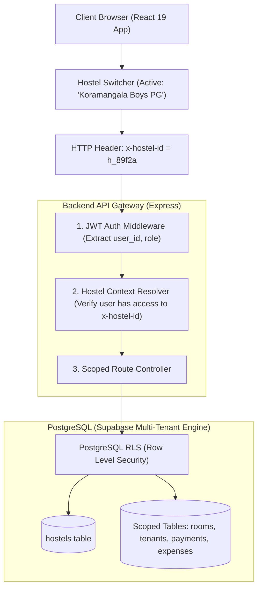
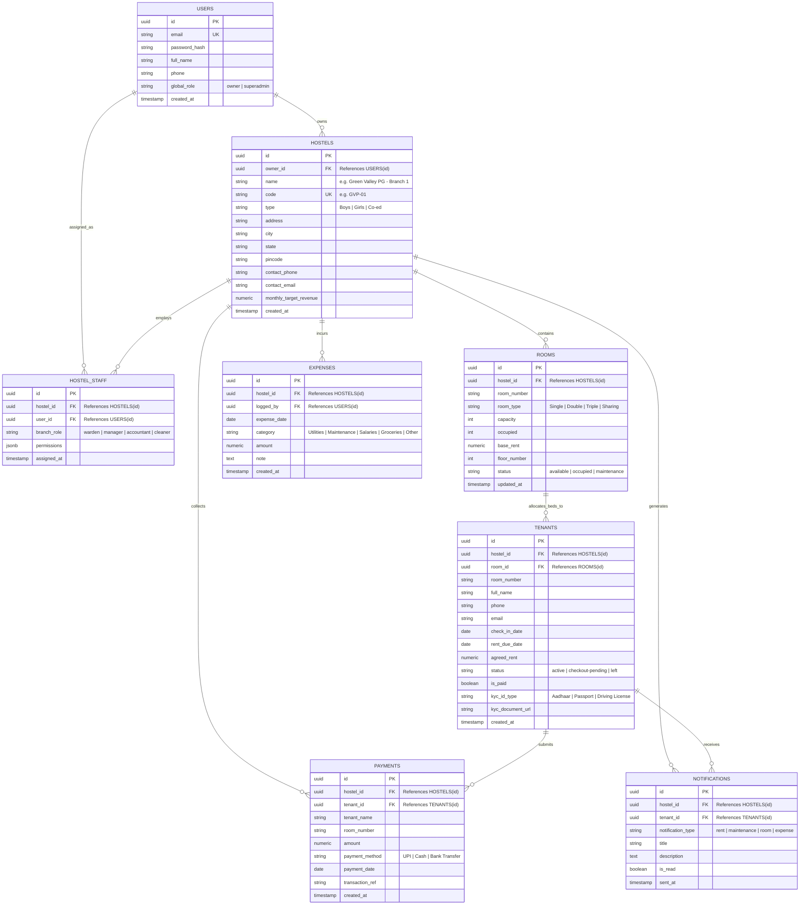
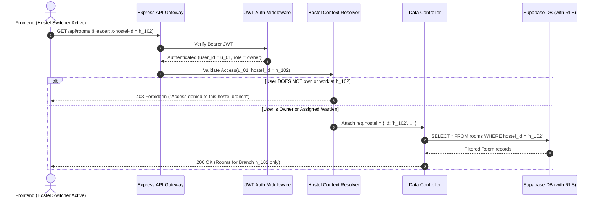
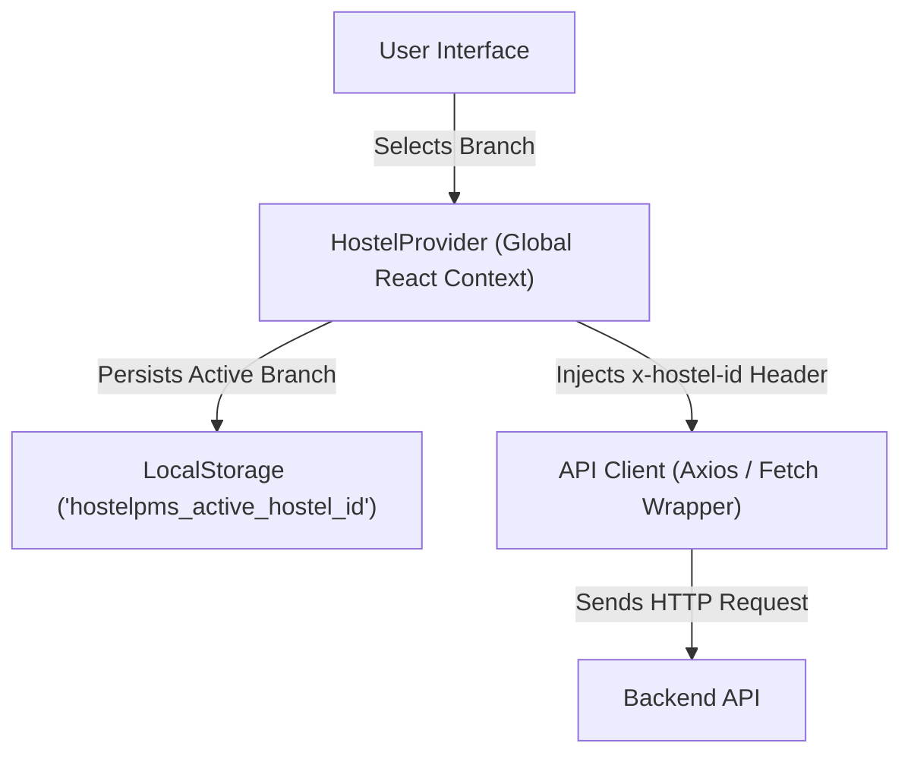

# HostelPMS — System Design Document
## Multi-Tenancy Architecture (Multi-Hostel & Multi-Branch Management)

**Document Version:** 2.0.0  
**Status:** Approved  
**Author:** Antigravity Engineering  
**Architecture Pattern:** Pooled Multi-Tenancy (Shared Database, Shared Schema with Tenant & Branch Discriminators)  
**Target Audience:** Software Architects, Full-Stack Developers, DevOps Engineers  

---

## 1. Executive Summary & Multi-Tenancy Vision

**HostelPMS** is designed from the ground up to support **Hierarchical Multi-Tenancy**. A single client or property owner can operate an entire chain or portfolio of multiple hostels/PGs across different locations, cities, and property types (Boys, Girls, Co-ed) under a unified administrative umbrella.

### Core Multi-Tenancy Capabilities:
1. **Multi-Hostel Portfolio Dashboard:** An owner can view aggregated portfolio metrics (total beds across all hostels, total monthly revenue, pending rent dues across branches) or drill down into an individual hostel branch.
2. **Branch Switching:** Seamless switching between hostels directly from the header dropdown without re-authenticating.
3. **Role-Based Access Control (RBAC):**
   - **Super Admin / Property Owner:** Full access to all owned hostels, financial ledgers, staff assignments, and portfolio analytics.
   - **Branch Warden / Property Manager:** Scoped access strictly restricted to their assigned hostel branch (e.g., managing rooms, tenants, and day-to-day check-ins for "Branch A" only).
   - **Accountant / Bookkeeper:** Read/write access to financial records (payments, expenses) across designated hostels.
4. **Isolated Operational Data:** Rooms, tenants, maintenance issues, utility bills, and payment records are logically separated by `hostel_id`.

---

## 2. Multi-Tenancy Architectural Model

### 2.1 Isolation Strategy: Shared Database, Shared Schema (Discriminator-Based)

To provide the ideal balance between operational cost, scaling efficiency, and code maintainability, HostelPMS implements the **Tenant & Branch Discriminator Pattern**:

- **Database:** Single PostgreSQL database instance via Supabase.
- **Tenant Scope:** Every domain table (`rooms`, `tenants`, `payments`, `expenses`, `notifications`, `staff`) contains an indexed `hostel_id` foreign key.
- **Enforcement:** Enforced at two layers:
  1. **Application Layer:** Express middleware (`hostelContextMiddleware`) extracts and validates the tenant context (`x-hostel-id` header).
  2. **Database Layer:** Supabase **Row Level Security (RLS)** policies prevent cross-tenant data leakage even in the event of an application-level query mistake.



---

## 3. Hierarchical Data Model & Schema Design

### 3.1 Entity Relationship Diagram (Multi-Hostel)



---

## 4. Multi-Hostel Context Resolution & Security

### 4.1 Request Lifecycle & Context Middleware



### 4.2 Supabase Row-Level Security (RLS) Policy Example

```sql
-- Enable RLS on domain tables
ALTER TABLE hostels ENABLE ROW LEVEL SECURITY;
ALTER TABLE rooms ENABLE ROW LEVEL SECURITY;
ALTER TABLE tenants ENABLE ROW LEVEL SECURITY;
ALTER TABLE payments ENABLE ROW LEVEL SECURITY;

-- 1. Hostel Access Policy: Owners see their hostels, Wardens see assigned hostels
CREATE POLICY hostel_access_policy ON hostels
  FOR ALL
  USING (
    owner_id = auth.uid() OR
    EXISTS (
      SELECT 1 FROM hostel_staff
      WHERE hostel_staff.hostel_id = hostels.id
      AND hostel_staff.user_id = auth.uid()
    )
  );

-- 2. Scoped Entity Policy (e.g., Rooms):
CREATE POLICY room_isolation_policy ON rooms
  FOR ALL
  USING (
    EXISTS (
      SELECT 1 FROM hostels
      WHERE hostels.id = rooms.hostel_id
      AND (
        hostels.owner_id = auth.uid() OR
        EXISTS (
          SELECT 1 FROM hostel_staff
          WHERE hostel_staff.hostel_id = rooms.hostel_id
          AND hostel_staff.user_id = auth.uid()
        )
      )
    )
  );
```

---

## 5. API Design for Multi-Tenancy

### 5.1 Hostel Management Endpoints (`/api/hostels`)

| Method | Endpoint | Description | Role Required |
| :--- | :--- | :--- | :--- |
| `GET` | `/api/hostels` | List all hostels owned or accessible to the user | Authenticated |
| `POST` | `/api/hostels` | Register a new hostel branch (name, address, rooms) | Owner |
| `GET` | `/api/hostels/:id` | Get details and settings of a specific hostel branch | Owner / Warden |
| `PUT` | `/api/hostels/:id` | Update hostel profile, rent terms, or contact details | Owner |
| `DELETE` | `/api/hostels/:id` | Decommission / Archive a hostel branch | Owner |
| `GET` | `/api/hostels/portfolio/summary` | Aggregated portfolio metrics (all branches combined) | Owner |

### 5.2 Branch-Scoped Endpoints

All operational endpoints accept the active branch context via header `x-hostel-id`:
- **Rooms:** `GET /api/rooms`, `POST /api/rooms`
- **Tenants:** `GET /api/tenants`, `POST /api/tenants`
- **Payments:** `GET /api/payments`, `POST /api/payments`
- **Expenses:** `GET /api/expenses`, `POST /api/expenses`
- **Email Dispatch:** `POST /api/email/rent-reminder` (automatically injects the specific hostel's name, bank details, and branding into the email template)

---

## 6. Frontend Multi-Hostel UX & State Architecture

### 6.1 Hostel Switcher & State Store

The frontend provides a **Hostel Context Provider** (`HostelContext`) wrapping the application:



### 6.2 Navigation & View Modes:
1. **Branch View Mode:** When an individual hostel is selected (e.g., *"Indiranagar Girls Hostel"*), all pages (`/rooms`, `/tenants`, `/payments`, `/expenses`) display live operational data for that branch only.
2. **Portfolio View Mode:** When *"All Hostels (Portfolio)"* is selected, the executive dashboard displays:
   - Total beds capacity across all hostels.
   - Aggregate occupancy rate percentage ($\sum \text{occupied} / \sum \text{capacity} \times 100$).
   - Comparative revenue bar charts comparing performance across different branches.
   - Combined rent arrears list categorized by branch.

---

## 7. Migration & Rollout Plan

1. **Database Migration:** Create the `hostels` and `hostel_staff` tables; alter `rooms`, `tenants`, `payments`, and `expenses` to include `hostel_id REFERENCES hostels(id) ON DELETE CASCADE`.
2. **Seed Default Property:** Automatically create a "Main Branch" for existing single-hostel accounts and backfill existing rooms and tenants with the default `hostel_id`.
3. **Backend Middleware Integration:** Add `hostelContextMiddleware.ts` to validate the `x-hostel-id` header on all protected routes.
4. **Frontend Dropdown Component:** Introduce the `<HostelSwitcher />` in the top navigation bar of `AppShell.tsx`.
